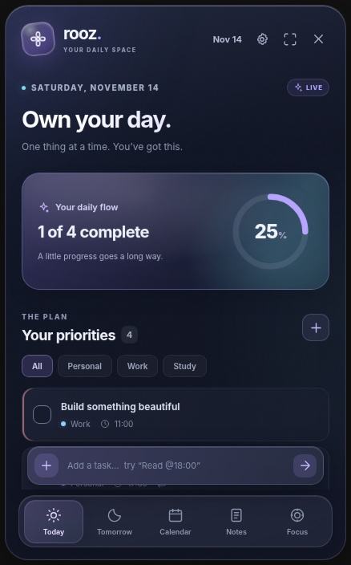

# Rooz v0.2 — your daily space ✦

**A real native Linux desktop application rewritten with Tauri 2, Rust, SQLite, and an unusually lightweight TypeScript UI.** No Electron. No external font, animation, or UI-library dependencies. No account or background network connection. The interface uses transparent, multi-layer glass panels, reflective edge lighting, interactive 3D tilt, animated transitions, and a compact corner widget/expanded workspace layout.

> **Important build status:** Frontend TypeScript compiles cleanly, browser-interaction tests pass, and screenshots are included. The native Rust/Tauri binary has **not** been compiled here because this build container does not have `cargo`/`rustc` or access to install them. This is a **source release**, not a verified ready-to-run AppImage. Build it on Arch or use the included GitHub Actions workflow.



## Install on Arch / EndeavourOS

Run in this extracted folder:

```bash
# Optional but recommended: stop the older GTK Rooz before switching versions.
./scripts/install-arch.sh
~/.local/bin/rooz
```

The installer updates Arch dependencies, installs the Rust Tauri 2 CLI if necessary, builds a native binary, registers the launcher, and enables session autostart. Nothing in `~/.local/share/rooz/` is removed.

Manual build / development:

```bash
sudo pacman -Syu --needed rust cargo base-devel pkgconf webkit2gtk-4.1 gtk3 \
  curl wget file openssl appmenu-gtk-module libappindicator-gtk3 librsvg xdotool
cargo install tauri-cli --version '^2.0.0' --locked
cargo tauri dev                    # native debug window
cargo tauri build --no-bundle      # direct local binary
./scripts/install-built.sh        # install compiled binary + autostart
# Or: cargo tauri build --bundles appimage
```

The checked-in `web/*.js` is built from `frontend/*.ts`. To change TypeScript, use `tsc --noEmit` to verify and `tsc` to regenerate output (TypeScript can be installed separately). **Tauri needs no frontend npm packages.**

## Functionality

- **Today and Tomorrow:** tasks, completion tracking, priorities, categories, notes, times, reminders, repeat daily/weekly, drag/drop reorder, quick capture with `@14:30`, `tomorrow`, `#work`, `!`/`!!` keywords.
- **Calendar:** interactive month grid and day-specific scheduling; Gregorian date engine with Persian-localized date labels, not a native Jalali grid.
- **Notes:** categorized searchable cards, HTML rich-text editor with selection bubble, bold/italic/underline/highlight/heading/lists/links, Markdown-source toggle, Markdown export and local autosave.
- **Link cards:** safe clickable URL/hostname previews in notes. **Not** remote OpenGraph previews: no automatic network access.
- **Focus:** 15/25/45/60 minute timer, pause/resume/reset, completion chime; elapsed time is based on the actual clock (no `setInterval` drift).
- **Command center:** Ctrl+K fuzzy-style substring search over actions, tasks and notes, keyboard navigation.
- **Native reminder loop:** Rust thread checks tasks every 20 seconds, persists reminder fingerprints in SQLite, sends system notifications, optionally speaks through `spd-say` / Speech Dispatcher; continues when the window is hidden. 5-minute snooze is available on previously alerted timed tasks from the task details dialog.
- **Desktop integration:** single-instance CLI, tray icon, launch-at-login desktop file, `--toggle`, `--background`, `--hide` and `--quit` support.
- **RTL/LTR:** Persian/English setting controls writing direction, controls, labels and date localization. Some microcopy remains in English.

## UX shortcuts

| Shortcut | Action |
| --- | --- |
| `Ctrl+1` … `Ctrl+5` | Today, Tomorrow, Calendar, Notes, Focus |
| `Ctrl+K` | Search/command palette (link tool while editing a note) |
| `/` | Jump to quick capture / note search |
| `N` | New task or note (outside inputs) |
| `Ctrl+S` | Save the open note |
| `Esc` | Dismiss, back, or hide |

Rooz at login: `$HOME/.config/autostart/ir.aasoft.rooz.desktop`. Window close hides the app so background reminders keep running. To fully quit: system tray → **Quit completely**.

## KDE Plasma window placement

**X11:** the native Rust code requests bottom-right placement (a margin above the Plasma panel). **Wayland:** standard Tauri window placement is restricted by Wayland's security model; exact anchoring is *not guaranteed*. On KDE Plasma Wayland, use **System Settings → Window Management → Window Rules** to match the Rooz window and configure initial size/position. The compact dimensions are 438×704; use the KWin property detector to select the app identity. The app's `--toggle` can be bound to a KDE custom shortcut; match `rooz` or `ir.aasoft.rooz` depending on detected window class.

## Data migration and privacy

Uses the **same existing database** as Rooz v0.1: `~/.local/share/rooz/rooz.db`. On first run, one non-destructive `body_format` column is added to `notes`; old note bodies remain in Markdown format and render in the new editor. Tasks and notes are not deleted or reset. **Stop the old GTK app before launching the new one**, and make a backup if the data is important:

```bash
sqlite3 ~/.local/share/rooz/rooz.db ".backup '$HOME/rooz-backup.db'"
```

The preview in a normal browser intentionally starts with illustrative sample data saved in that browser's localStorage. That demo is **separate** from the native SQLite database; native first launch does not import the demo.

## Performance model

One native WebKitGTK WebView, no Node process, no React render cycle, and no graphics engine. CSS glass, native opacity/transforms and GPU-composited transitions; 3D tilt only reacts to pointer movement. JS only updates when data changes or the focus timer ticks. The Rust reminder thread is independent of WebView scheduling. Actual FPS, memory consumption and native window performance still require testing on an Arch KDE machine.

## Tests

```bash
# TypeScript checks + JS emission: tsc  (if installed)
tsc --noEmit
tsc
# Headless Chromium UI integration test requires Python playwright and /usr/bin/chromium
python3 tests/bundle_for_test.py
python3 tests/smoke.py
# Native checks on a configured Arch build host:
cd src-tauri && cargo test
```

The headless test uses inline local CSS/JS because the development environment blocked Chromium from navigating localhost. This is a test harness only; Tauri loads the real ES modules from `web/`.

## Directory map

- `src-tauri/src/lib.rs`: Rust/SQLite persistence, schema migration, native reminders, tray, window management.
- `src-tauri/capabilities/default.json`: restrictive Tauri capability.
- `frontend/{backend,views,editor,app}.ts`: dependency-free TypeScript source.
- `web/{app,views,editor,backend}.js` + `style.css`: compiled UI, complete visual theme.
- `scripts/install-arch.sh`: Arch build/installation/autostart.
- `.github/workflows/linux-appimage.yml`: automated AppImage build.
- `tests`: browser integration tests; `preview`: UI screenshots.

### Known limitations

Native compilation was not performed here. Certain WebKitGTK versions may differ from Chromium in contenteditable toolbar/transparent-window behavior. Reminder delivery and Persian TTS depend on the local desktop notification and Speech Dispatcher services; no guarantee of natural Persian speech. GNOME Wayland has further placement restrictions. Clipboard operations, drag/drop to external apps, CalDAV/Google Calendar sync, true Jalali grid, full WYSIWYG tables/media and natural-language AI scheduling are **not** included in this source release.

MIT License. Design informed by the glasswork/ThreeUI/Motionin/60fps design references, but original implementation rather than copied code.
